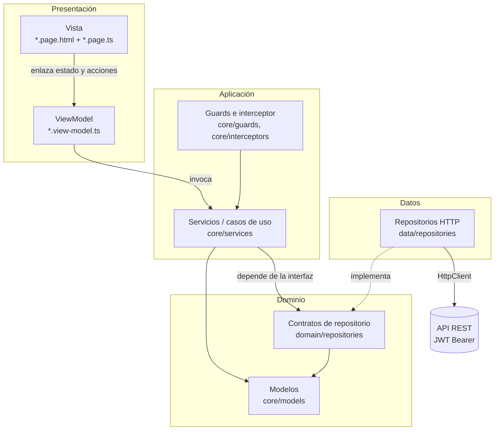

# Arquitectura de Tiozihuatl Mobile

La app está construida con **Ionic + Angular + Capacitor** y sigue el patrón **MVVM** organizado en capas al estilo **Clean Architecture**: cada capa depende solo de la capa interior y se comunica con ella por contratos (interfaces), no por implementaciones.

## Capas



| Capa | Carpeta | Responsabilidad |
|---|---|---|
| Presentación: Vista | `src/app/pages/**/*.page.html`, `*.page.ts` | Plantilla y enlace con el ViewModel. No contiene reglas de negocio ni llamadas HTTP. |
| Presentación: ViewModel | `src/app/pages/**/*.view-model.ts` | Estado de la pantalla en *signals*, validaciones del formulario y acciones (enviar, paginar, reintentar). |
| Aplicación | `src/app/core/services`, `core/guards`, `core/interceptors` | Casos de uso: iniciar sesión, renovar el token, registrar visitante, recuperar contraseña, consultar el catálogo con control de rol. Traduce errores técnicos a mensajes para el usuario. |
| Dominio | `src/app/core/models`, `src/app/domain/repositories` | Modelos de datos y contratos `AuthRepository` y `LibraryRepository`. No conoce Angular HTTP. |
| Datos | `src/app/data/repositories` | `HttpAuthRepository` y `HttpLibraryRepository`: implementan los contratos sobre la API REST. |

### Cómo se aplica MVVM

- **Model:** modelos de `core/models` y los servicios que obtienen los datos a través de los repositorios.
- **View:** la plantilla HTML y la clase de la página, que solo reexpone lo que tiene el ViewModel.
- **ViewModel:** `LoginViewModel` (`pages/login/login.view-model.ts`) y `LibraryViewModel` (`pages/biblioteca/library.view-model.ts`) concentran el estado y la lógica de la pantalla. Se pueden probar sin montar la vista.

Las demás pantallas siguen la misma separación dentro de su clase: la plantilla solo enlaza *signals* y métodos, y la lógica de datos vive en los servicios.

## Patrones de diseño

| Patrón | Dónde | Para qué |
|---|---|---|
| **MVVM** | `*.page.ts` + `*.view-model.ts` | Separar la vista del estado y la lógica de presentación. |
| **Repository** | `domain/repositories/*.repository.ts` (contrato) y `data/repositories/http-*.repository.ts` (implementación) | Los servicios no dependen de `HttpClient`; el origen de los datos se puede cambiar o simular en pruebas. |
| **Factory** | `AUTH_REPOSITORY`, `LIBRARY_REPOSITORY` y `PDF_READER_SOURCE` (`InjectionToken` con `factory`) | Decide qué implementación se entrega a quien la pide. |
| **Singleton** | Servicios y repositorios con `providedIn: 'root'` | Una sola instancia compartida: sesión, autenticación y caché del catálogo. |
| **Observer** | RxJS (`Observable`, `shareReplay`) y *signals* de Angular | La vista se actualiza sola cuando cambia el estado; varias peticiones de renovación comparten una sola respuesta. |
| **Interceptor (Chain of Responsibility)** | `core/interceptors/auth.interceptor.ts` | Agrega el token `Bearer` a cada petición a la API. |
| **Guard** | `core/guards/auth.guard.ts` | Protege rutas por sesión y por rol. |

## Pruebas de caja blanca

Las pruebas unitarias y de integración están en archivos `*.spec.ts` **junto al archivo que prueban**. Es la convención oficial de Angular: cada prueba importa su archivo con una ruta corta, y si el archivo se mueve, la prueba se mueve con él. Por eso no hay una carpeta `/test` para estas pruebas.

| Tipo | Dónde | Herramienta |
|---|---|---|
| Unitarias (servicios, repositorios, ViewModels, guards, interceptor, validadores) | `src/app/**/*.spec.ts` | Vitest |
| Integración de componentes (página + servicio + router, con la API simulada por `HttpTestingController`) | `src/app/pages/**/*.page.spec.ts`, `src/app/app.routes.spec.ts` | Vitest + TestBed |
| Integración con la API real | `tests/postman/` | Newman |

La cobertura se mide sobre las rutas de `angular.json` → `test.options.coverageInclude`, con un mínimo del 70 % en sentencias, ramas, funciones y líneas. Si baja de ese mínimo, el job **Pruebas unitarias (Vitest)** del pipeline falla. El reporte HTML queda como artefacto `reporte-cobertura` en cada ejecución de `pruebas.yml`.

Para correrlas localmente:

```
npx ng test --configuration ci
```
